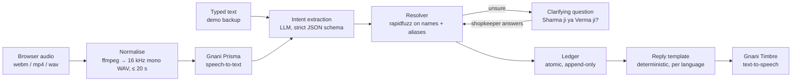

# KhaataFlow backend

KhaataFlow is a voice-first shop book for Indian kirana merchants. The shopkeeper speaks in any of the 10 Indian languages Gnani supports, or Hinglish ("Sharma ji ka paanch sau udhaar likh do"), and KhaataFlow records customer udhaar, stock movement and staff attendance and advances, then answers back in voice. It is built for small shop owners who keep their accounts in a paper khata today.

Built for Gnani AI's Great Indian AI Internship Challenge.

## Gnani models used

| Model | What it does here | Where in the pipeline |
| - | - | - |
| **Prisma v3.0** (speech-to-text) | Turns the shopkeeper's recorded command into text. Called with the command's language (`bn-IN`, `en-IN`, `gu-IN`, `hi-IN`, `kn-IN`, `ml-IN`, `mr-IN`, `pa-IN`, `ta-IN` or `te-IN`; Hinglish uses `hi-IN`), `format=transcribe` (digits and ₹ for numbers), and the shop's party and product names as `keyterms`. | Stage 2, `modules/voice/providers/gnani.py` → `GnaniPrismaSTT` |
| **Timbre v2.5** (text-to-speech) | Speaks every reply, including errors and clarification questions, in the voice `Poorvi` and the command's language, so a Tamil command is answered in Tamil. Hinglish replies use `hi-IN`, so amounts are read in Hindi ("ek hazaar do sau pachaas rupaye"); with `hi-en` Timbre read them in English. | Stage 8, `modules/voice/providers/gnani.py` → `GnaniTimbreTTS` |

Both use Gnani's non-streaming REST endpoints (`POST /stt/v3`, `POST /api/v1/tts/inference`). Intent extraction uses `openai/gpt-oss-120b` on Groq, because Gnani's own LLM is not on the Gnani API platform.

## Architecture



Every stage records its time in `VoiceCommand.timings_ms` and moves `stage` forward (`RECEIVED` → `TRANSCRIBED` → `PARSED` → `COMMITTED` / `ANSWERED` / `NEEDS_CLARIFICATION` / `FAILED`), so a failed command shows exactly where it stopped. Any provider or business-rule error becomes a polite spoken reply ("Maaf kijiye, samajh nahi aaya. Dobara boliye."), never a 500.

## Design decisions

- **Append-only ledger with reversals.** `ledger.Entry` rows are never updated or deleted. "Undo" writes a `REVERSAL` entry that points at the original, so the history of every mistake and correction stays visible. A database check constraint enforces which fields each entry kind needs.
- **Derived balances.** Customer balances, stock levels and staff dues are always computed from entries, never stored, so they cannot drift out of sync. Reversed entries and reversals are excluded in one place (`live_entries()`).
- **Deterministic response templates.** The LLM only proposes a structured command. Replies come from fixed per-language templates (`modules/voice/responses.py`, wording in `modules/voice/replies/<code>.json`), so they are fast, testable and never invent a number.
- **Clarification instead of guessing.** If a name is ambiguous ("Varma ji" sits between Verma ji and Sharma ji), unknown, or an amount is unusually large, KhaataFlow asks a yes/no or either/or question and waits up to 2 minutes for the answer. Nothing is written until it is sure.
- **Provider interfaces with fakes.** Speech-to-text, text-to-speech and the intent parser sit behind small interfaces. Tests and the text-command path run on fakes, so the test suite never calls Gnani or the LLM.

## Code conventions

Same `base/` layer as the owner's certifier project:

- **Models** inherit `base.model.ModelBase`: `uuid`, `status` (`CREATED` / `UPDATED` / `DELETED`), `created_at`, `updated_at`. Deletion is soft (`soft_delete()`); the default manager hides deleted rows, and uniqueness rules only count rows that aren't deleted. Ledger entries stay `CREATED` forever.
- **Views** subclass `base.views.BaseAV` (or `BaseViewSet` for CRUD). Handlers can return a dict or pydantic model; the shared 400/401/403/409 error responses are added to the OpenAPI schema automatically. `authentication = False` (or a per-method dict) makes an endpoint public.
- **Serializers** subclass `base.serializers.BaseSerializer`: per-call `fields=` / `exclude=` and `dynamic_keys` such as `"party.name"` → `party_name`.
- Business logic lives in `services.py` / `pipeline.py`, not in views.

## Measured numbers

Only numbers from real runs, measured on 9 November 2026 on a laptop running the Docker stack, with Groq `openai/gpt-oss-120b` at `reasoning_effort=medium`.

- **Intent accuracy: 35/36 (97.2%)** on the golden set (`modules/voice/tests/golden_commands.yaml`, run with `scripts/eval_intents.py`), in each of the last two runs. These are 36 synthetic transcripts covering every intent, in Devanagari and romanised Hinglish, with Hindi number words and messy phrasing. The one miss differed between runs and was harmless both times: an extra `date_hint` of today, then an extra `product_name` on an udhaar command (neither changes what gets written). The set is small and written by us, so treat it as a regression check, not a benchmark.
- With `reasoning_effort=low` the golden set scored 36/36 and was about 250 ms faster, but in real spoken commands the model garbled some names ("Rathore ji" became "Rathoth ji"), so `medium` is the default (`LLM_REASONING_EFFORT`).
- **Median latency per stage**, from 7 spoken commands across both demo shops (synthetic Timbre audio sent through `POST /voice/commands/`; all 7 answered correctly):

  | Stage | Median |
  | - | - |
  | Normalise audio (ffmpeg) | 83 ms |
  | Gnani Prisma speech-to-text | 457 ms |
  | Intent extraction (Groq) | 950 ms |
  | Resolve + ledger write or query | ~10 ms |
  | Gnani Timbre text-to-speech | 986 ms |
  | **Whole request** | **2,841 ms** |

  Across the 36 golden-set calls, the median intent latency was 1,140 ms.

- Groq's free tier allows 8,000 tokens a minute and each command uses about 1,450, so roughly 5 commands a minute. On a rate limit the parser waits up to 10 seconds and retries once. If Groq's strict JSON mode fails on a reply, the parser retries once without it and validates the result itself.

## Setup

Needs Docker. Python 3.13 and `uv` only if you want to run things outside Docker.

```bash
cp .env.example .env          # then set SECRET_KEY, GNANI_API_KEY and LLM_API_KEY
export COMPOSE_FILE=docker/nonprod/docker-compose.yml   # or pass -f with every compose command
mkcert -install && mkcert -cert-file docker/nonprod/certs/localhost.pem \
       -key-file docker/nonprod/certs/localhost-key.pem localhost 127.0.0.1 ::1   # once; certs stay out of git
docker compose up -d          # Postgres (latest), Redis, migrations, HTTPS API on :8000, Celery worker
DEMO_PASSWORD=<pick one> docker compose exec -e DEMO_PASSWORD web python manage.py seed_demo
                              # two demo merchants; prints each API token once (and a random password if DEMO_PASSWORD is unset)
docker compose exec web python manage.py drf_create_token gupta_store   # show a merchant's token again
docker compose exec web python manage.py createsuperuser     # for /admin/
docker compose exec web python manage.py gnani_smoke_test    # one real Prisma + Timbre call each
```

Edits to `.env` apply without restarting anything: Django reads the file itself, the dev server reloads when it changes, and the Celery worker runs under `watchfiles`. Leave `DATABASE_URL` and `REDIS_URL` unset when using Docker.

Migrations are generated by the `init` service on start-up and are not committed, the same as the owner's other projects.

The dev server is `runsslserver` (django-sslserver-v2) with a locally trusted mkcert certificate, so everything is on `https://localhost:8000` and plain `http://` is refused. The live transcript is the one async piece: a WebSocket (`modules/voice/stream.py`, served by uvicorn as the `stream` service on `wss://localhost:8001`) that relays the browser's microphone to Gnani's streaming speech-to-text and sends each phrase back while the shopkeeper speaks. The web app's server calls the API with `NODE_EXTRA_CA_CERTS="$(mkcert -CAROOT)/rootCA.pem"`, keeping TLS verification on.

- API docs: https://localhost:8000/api/schema/swagger-ui/ (Swagger) and https://localhost:8000/api/schema/redoc/ (ReDoc)
- Admin: https://localhost:8000/admin/
- Tests: `docker compose exec web pytest`
- Lint: `uv run ruff check .`
- Intent eval: `docker compose exec web python scripts/eval_intents.py`

## API

All endpoints are under `/api/v1/` and only ever see the caller's own shop. Everything except sign-in, register and the language catalogs needs `Authorization: Token <token>`. Errors look like `{"error": {"code": "...", "message": "..."}}`. Updates are always `PUT` with the full object; `PATCH` is not accepted anywhere (405).

```bash
API=https://localhost:8000/api/v1

# Sign in (10 tries a minute), register, sign out, the shop's settings
curl -H "Content-Type: application/json" -d '{"username": "gupta_store", "password": "..."}' $API/auth/login/   # → token, shop
curl -H "Content-Type: application/json" \
     -d '{"shop_name": "...", "username": "...", "password": "...", "preferred_language": "ta-IN"}' $API/auth/register/
TOKEN=<the token from sign-in or seed_demo>
curl -H "Authorization: Token $TOKEN" -X POST $API/auth/logout/
curl -H "Authorization: Token $TOKEN" -X PUT -H "Content-Type: application/json" \
     -d '{"preferred_language": "bn-IN"}' $API/me/                        # also GET

# Voice command (multipart audio, any format the browser records); the language defaults to the shop's
curl -H "Authorization: Token $TOKEN" -F audio=@command.webm -F language=hi-IN $API/voice/commands/

# Text command: same pipeline without speech-to-text (the demo backup)
curl -H "Authorization: Token $TOKEN" -H "Content-Type: application/json" \
     -d '{"text": "Sharma ji ka 500 udhaar likh do"}' $API/voice/text-commands/

# Answer a clarifying question
curl -H "Authorization: Token $TOKEN" -H "Content-Type: application/json" \
     -d '{"option_id": "party:2"}' $API/voice/commands/42/clarify/
curl -H "Authorization: Token $TOKEN" -H "Content-Type: application/json" \
     -d '{"confirm": true}' $API/voice/commands/42/clarify/

curl -H "Authorization: Token $TOKEN" "$API/voice/commands/?page=1"      # history, newest first
curl -H "Authorization: Token $TOKEN" $API/voice/commands/42/audio/     # reply audio, owner only
curl -H "Authorization: Token $TOKEN" -X POST $API/voice/stream-ticket/  # 30-second ticket for the live transcript
# then wss://localhost:8001/api/v1/voice/stream/?ticket=…&language=hi-IN : send 1,024-byte frames of 16 kHz 16-bit
# mono PCM, "commit" to finish the phrase; each message back is {"text": "…"}

# Data: every list takes page and page_size, plus q (search) and ordering
curl -H "Authorization: Token $TOKEN" "$API/parties/?kind=CUSTOMER&q=sharma&balance=owing&ordering=-balance"
curl -H "Authorization: Token $TOKEN" "$API/parties/?kind=STAFF&advance=yes&month=2026-11"   # with staff_due
curl -H "Authorization: Token $TOKEN" "$API/parties/3/month/?month=2026-10"   # staff due and days present
curl -H "Authorization: Token $TOKEN" "$API/products/?low=true&ordering=stock_level"
curl -H "Authorization: Token $TOKEN" "$API/entries/?kind=CREDIT_GIVEN,PAYMENT_RECEIVED&party=2&date_from=2026-11-01"
                              # filtered to one customer, rows carry running_balance
curl -H "Authorization: Token $TOKEN" -H "Content-Type: application/json" \
     -d '{"kind": "PAYMENT_RECEIVED", "party": 2, "amount": "200"}' $API/entries/   # 409 if more than the balance
curl -H "Authorization: Token $TOKEN" -X POST $API/entries/17/undo/
curl -H "Authorization: Token $TOKEN" $API/summary/                     # dashboard: totals, 14 days, recent

# Interface text for the web app (no sign-in needed)
curl $API/i18n/              # the 11 languages with native names
curl $API/i18n/ta-IN/        # one language's strings
```

A voice or text command returns `id`, `stage` (where the pipeline got to), `status` (the record's lifecycle, like every resource), `transcript`, `parsed`, `response_text`, `response_audio_url`, `entry` (if one was written), `clarification` (if a question is pending), `error_code` and `timings_ms`.

## Data note

All demo data is synthetic: the two shops (`gupta_store` → Gupta General Store, `patel_store` → Patel Provision Store), customers, staff, products and entries are made up, and no party has a phone number or any other contact detail. No real recordings are used; the smoke test transcribes Timbre's own synthetic speech unless you pass your own recording with `--audio`.

## Languages

The web app and voice replies come in Hinglish (`hi-Latn`, the original wording) and the 10 Gnani languages. Interface text is in `modules/i18n/catalogs/<code>.json` and spoken replies in `modules/voice/replies/<code>.json`; a test checks every file has the same keys and placeholders as the Hinglish one. **The translations other than Hinglish and English are machine-drafted and need review by native speakers before real shopkeepers use them.**

## Known limits

- Recordings and reply audio are never served from `/media/`. Reply audio is only available to the shop that owns it, through `/voice/commands/<id>/audio/`.
- One owner per shop; no roles.
