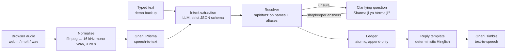

# KhaataFlow backend

KhaataFlow is a voice-first shop book for Indian kirana merchants. The shopkeeper speaks in Hindi or Hinglish ("Sharma ji ka paanch sau udhaar likh do") and KhaataFlow records customer udhaar, stock movement and staff attendance and advances, then answers back in voice. It is built for small shop owners who keep their accounts in a paper khata today.

Built for Gnani AI's Great Indian AI Internship Challenge.

## Gnani models used

| Model | What it does here | Where in the pipeline |
| - | - | - |
| **Prisma v3.0** (speech-to-text) | Turns the shopkeeper's recorded command into text. Called with `language_code=hi-IN`, `format=transcribe` (digits and ₹ for numbers), and the shop's party and product names as `keyterms`. | Stage 2, `modules/voice/providers/gnani.py` → `GnaniPrismaSTT` |
| **Timbre v2.5** (text-to-speech) | Speaks every reply, including errors and clarification questions, in the Hinglish voice `Poorvi` with `language=hi-IN`, so amounts are read in Hindi ("ek hazaar do sau pachaas rupaye"); with `hi-en` Timbre read them in English. | Stage 8, `modules/voice/providers/gnani.py` → `GnaniTimbreTTS` |

Both use Gnani's non-streaming REST endpoints (`POST /stt/v3`, `POST /api/v1/tts/inference`). Intent extraction uses `openai/gpt-oss-120b` on Groq, because Gnani's own LLM is not on the Gnani API platform.

## Architecture



Every stage records its time in `VoiceCommand.timings_ms` and moves `stage` forward (`RECEIVED` → `TRANSCRIBED` → `PARSED` → `COMMITTED` / `ANSWERED` / `NEEDS_CLARIFICATION` / `FAILED`), so a failed command shows exactly where it stopped. Any provider or business-rule error becomes a polite spoken reply ("Maaf kijiye, samajh nahi aaya. Dobara boliye."), never a 500.

## Design decisions

- **Append-only ledger with reversals.** `ledger.Entry` rows are never updated or deleted. "Undo" writes a `REVERSAL` entry that points at the original, so the history of every mistake and correction stays visible. A database check constraint enforces which fields each entry kind needs.
- **Derived balances.** Customer balances, stock levels and staff dues are always computed from entries, never stored, so they cannot drift out of sync. Reversed entries and reversals are excluded in one place (`live_entries()`).
- **Deterministic response templates.** The LLM only proposes a structured command. Replies come from fixed templates (`modules/voice/responses.py`), so they are fast, testable and never invent a number.
- **Clarification instead of guessing.** If a name is ambiguous ("Varma ji" sits between Verma ji and Sharma ji), unknown, or an amount is unusually large, KhaataFlow asks a yes/no or either/or question and waits up to 2 minutes for the answer. Nothing is written until it is sure.
- **Provider interfaces with fakes.** Speech-to-text, text-to-speech and the intent parser sit behind small interfaces. Tests and the text-command path run on fakes, so the test suite never calls Gnani or the LLM.

## Code conventions

Same `base/` layer as the owner's certifier project:

- **Models** inherit `base.model.ModelBase`: `uuid`, `status` (`CREATED` / `UPDATED` / `DELETED`), `created_at`, `updated_at`. Deletion is soft (`soft_delete()`); the default manager hides deleted rows, and uniqueness rules only count rows that aren't deleted. Ledger entries stay `CREATED` forever.
- **Views** subclass `base.views.BaseAV` (or `BaseViewSet` for CRUD). Handlers can return a dict or pydantic model; the shared 400/401/403/409 error responses are added to the OpenAPI schema automatically. `authentication = False` (or a per-method dict) makes an endpoint public.
- **Serializers** subclass `base.serializers.BaseSerializer`: per-call `fields=` / `exclude=` and `dynamic_keys` such as `"party.name"` → `party_name`.
- Business logic lives in `services.py` / `pipeline.py`, not in views.

## Measured numbers

Only numbers from real runs, measured on 9 November 2026 on a laptop running the Docker stack.

- **Intent accuracy: 36/36 (100%)** on the golden set (`modules/voice/tests/golden_commands.yaml`, run with `scripts/eval_intents.py`). These are 36 synthetic transcripts covering every intent, in Devanagari and romanised Hinglish, with Hindi number words and messy phrasing. The set is small and written by us, so treat it as a regression check, not a benchmark.
- **Median latency per stage**, from 5 spoken commands (synthetic Timbre audio sent through `POST /voice/commands/`):

  | Stage | Median |
  | - | - |
  | Normalise audio (ffmpeg) | 65 ms |
  | Gnani Prisma speech-to-text | 424 ms |
  | Intent extraction (Groq `gpt-oss-120b`) | 1,016 ms |
  | Resolve + ledger write or query | ~12 ms |
  | Gnani Timbre text-to-speech | 971 ms |
  | **Whole request** | **2,639 ms** |

  Across the 36 golden-set calls, the median intent latency was 806 ms.

- Groq's free tier allows 8,000 tokens a minute and each command uses about 1,230, so roughly 6 commands a minute. On a rate limit the parser waits up to 10 seconds and retries once.

## Setup

Needs Docker. Python 3.13 and `uv` only if you want to run things outside Docker.

```bash
cp .env.example .env          # then set SECRET_KEY, GNANI_API_KEY and LLM_API_KEY
export COMPOSE_FILE=docker/nonprod/docker-compose.yml   # or pass -f with every compose command
docker compose up -d          # Postgres (latest), Redis, migrations, API on :8000, Celery worker
docker compose exec web python manage.py seed_demo           # two demo merchants; prints each API token once
docker compose exec web python manage.py drf_create_token gupta_store   # show a merchant's token again
docker compose exec web python manage.py createsuperuser     # for /admin/
docker compose exec web python manage.py gnani_smoke_test    # one real Prisma + Timbre call each
```

Edits to `.env` apply without restarting anything: Django reads the file itself, the dev server reloads when it changes, and the Celery worker runs under `watchfiles`. Leave `DATABASE_URL` and `REDIS_URL` unset when using Docker.

Migrations are generated by the `init` service on start-up and are not committed, the same as the owner's other projects.

- API docs: http://localhost:8000/api/schema/swagger-ui/ (Swagger) and http://localhost:8000/api/schema/redoc/ (ReDoc)
- Admin: http://localhost:8000/admin/
- Tests: `docker compose exec web pytest`
- Lint: `uv run ruff check .`
- Intent eval: `docker compose exec web python scripts/eval_intents.py`

## API

All endpoints are under `/api/v1/`, need `Authorization: Token <token>`, and only ever see the caller's own shop. Errors look like `{"error": {"code": "...", "message": "..."}}`.

```bash
TOKEN=<a merchant's token from seed_demo>
API=http://localhost:8000/api/v1

# Voice command (multipart audio, any format the browser records)
curl -H "Authorization: Token $TOKEN" -F audio=@command.webm -F language=hi-IN $API/voice/commands/

# Text command: same pipeline without speech-to-text (the demo backup)
curl -H "Authorization: Token $TOKEN" -H "Content-Type: application/json" \
     -d '{"text": "Sharma ji ka 500 udhaar likh do"}' $API/voice/text-commands/

# Answer a clarifying question
curl -H "Authorization: Token $TOKEN" -H "Content-Type: application/json" \
     -d '{"option_id": "party:2"}' $API/voice/commands/42/clarify/
curl -H "Authorization: Token $TOKEN" -H "Content-Type: application/json" \
     -d '{"confirm": true}' $API/voice/commands/42/clarify/

# Data
curl -H "Authorization: Token $TOKEN" "$API/parties/?kind=CUSTOMER"     # with balance
curl -H "Authorization: Token $TOKEN" "$API/parties/?kind=STAFF"        # with staff_due
curl -H "Authorization: Token $TOKEN" $API/products/                    # with stock_level, is_low
curl -H "Authorization: Token $TOKEN" "$API/entries/?kind=CREDIT_GIVEN&date_from=2026-11-01"
curl -H "Authorization: Token $TOKEN" -X POST $API/entries/17/undo/
curl -H "Authorization: Token $TOKEN" $API/summary/                     # dashboard header
```

A voice or text command returns `id`, `stage` (where the pipeline got to), `status` (the record's lifecycle, like every resource), `transcript`, `parsed`, `response_text`, `response_audio_url`, `entry` (if one was written), `clarification` (if a question is pending), `error_code` and `timings_ms`.

## Data note

All demo data is synthetic: the two shops (`gupta_store` → Gupta General Store, `patel_store` → Patel Provision Store), customers, staff, products and entries are made up, and no party has a phone number or any other contact detail. No real recordings are used; the smoke test transcribes Timbre's own synthetic speech unless you pass your own recording with `--audio`.

## Known limits

- Uploaded recordings and reply audio are served from `/media/` without authentication while `DEBUG` is on. Fine for a local demo; put media behind auth or signed URLs before real shopkeepers use it.
- One owner per shop; no roles.
